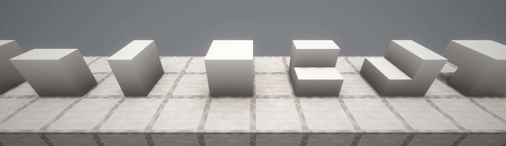
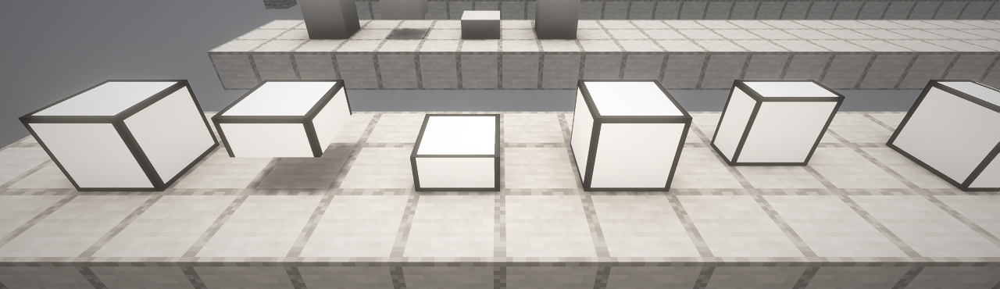
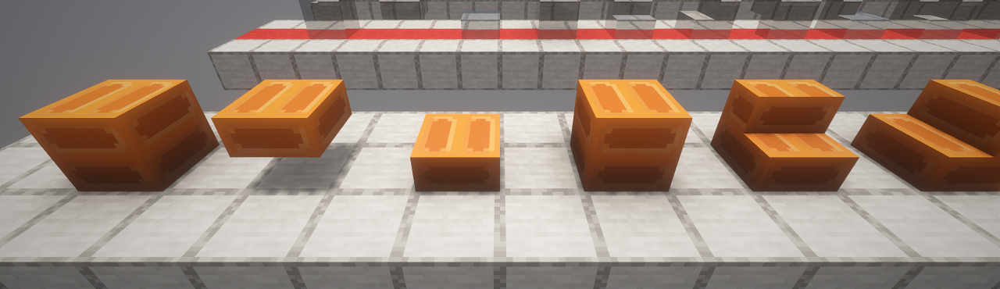
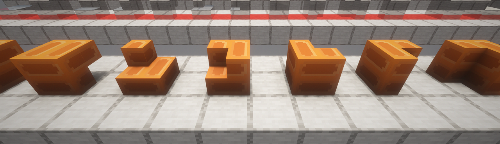
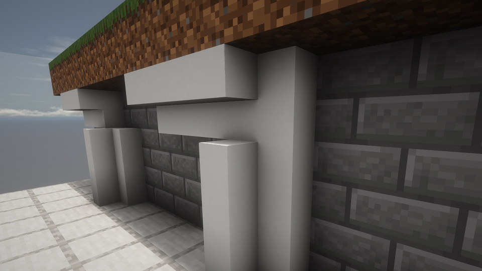
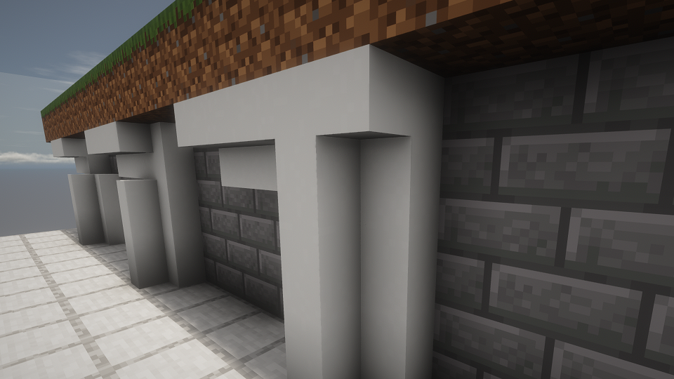
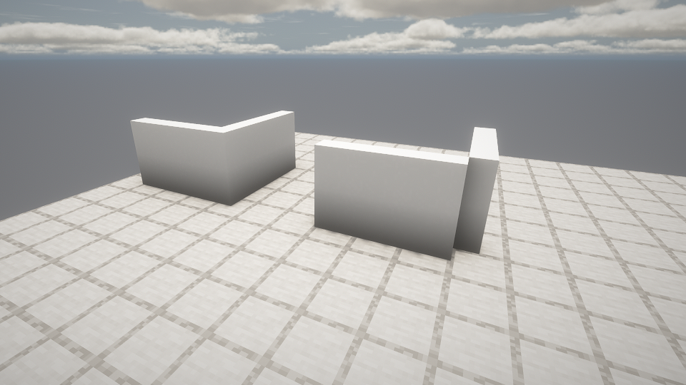
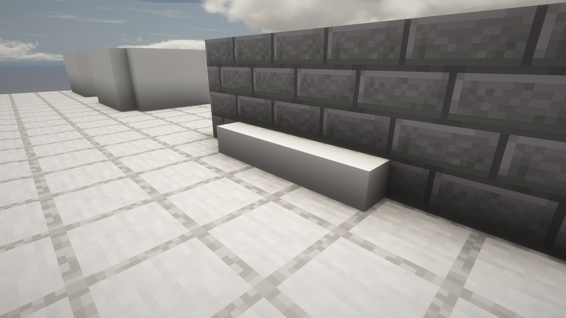

# Lathe

Lathe makes **slabs, vertical slabs, stairs, vertical stairs, corners, quarters and eighths for the blocks you choose**, from any mod. List the blocks in a small rules file and each one gets real shaped blocks that <strong>look, sound and mine like the original</strong>, with recipes, drops and tags. It's for modpacks whose builders and city palettes need shapes that the block's own mod never added.

***

## Requirements

<table>
  <tr><th align="left">What</th><th align="left">Version</th></tr>
  <tr><td><strong>Forge</strong></td><td>47.4.10 or later</td></tr>
  <tr><td><strong>Sides</strong></td><td><strong>Client and server</strong>, with the same rules files</td></tr>
</table>

***

## Choosing Blocks

One line per block in `config/lathe/`, the shapes first:

<pre>
# Shapes vanilla doesn't have
slab stairs vslab vstairs corners quarters eighths minecraft:calcite
slab vslab minecraft:*_concrete
slab vstairs minecraft:glass nocombine
</pre>

*   **Globs**: `minecraft:*_concrete` covers a whole family.
*   **nocombine**: two slabs of that block never merge into a double slab.
*   **Mistakes are warnings**: an unknown block or a block that isn't a full cube is skipped with a line in the log, not a crash.

**NOTE**: removing a rule removes its blocks from worlds that have them. Treat rule changes like adding or removing a mod.

***

## Placing And Breaking

*   **Slabs go where you aim**: the middle of a floor makes a bottom slab and its edge a vertical slab against that edge; on a wall, the middle makes a vertical slab against the wall and the top or bottom edge a top or bottom slab.
*   **One slab item** places both kinds, when a block has both.
*   **Vertical stairs** fill the corner where two vertical slabs meet and stack into matching columns; otherwise they open toward you, on the side you aim at.
*   **Corners** fill the gap where stairs and vertical stairs meet: the piece that fits where they overlap, or, sneaking, the piece that covers both. With nothing to fit, the corner goes where you aim.
*   **Quarters** fit too: the upright pole where two vertical slabs meet, or the next length of a beam or pole. With nothing to fit, or sneaking, a corner of a floor gives a pole and an edge a beam.
*   **Eighths** fill the spot where three slabs meet, or go in the quarter of the face you aim at.
*   **Double slabs break one half at a time**, and the outline shows which half.
*   **An outline previews** the piece you're about to place.

***

## Screenshots

<table>
  <tr>
    <td align="center"></td>
    <td align="center"></td>
  </tr>
  <tr>
    <td align="center"><strong>Vertical Slabs And Stairs</strong> BetterBlockZ's Lab Link Base</td>
    <td align="center"><strong>Glowing Blocks Stay Bright</strong> BetterBlockZ's Cyber Light</td>
  </tr>
  <tr>
    <td align="center"></td>
    <td align="center"></td>
  </tr>
  <tr>
    <td align="center"><strong>Slabs And Stairs</strong> A BetterBlockZ pillar block, original on the left</td>
    <td align="center"><strong>Stair Corners And Vertical Stairs</strong> The same block, turned every way</td>
  </tr>
  <tr>
    <td align="center"></td>
    <td align="center"></td>
  </tr>
  <tr>
    <td align="center"><strong>Outer Corner</strong> Upside-down stairs meeting vertical stairs</td>
    <td align="center"><strong>Inner Corner</strong> The same gap, placed while sneaking</td>
  </tr>
  <tr>
    <td align="center"></td>
    <td align="center"></td>
  </tr>
  <tr>
    <td align="center"><strong>Poles</strong> Closing the corner of two vertical slab walls, empty on the right</td>
    <td align="center"><strong>Beams</strong> Along the edge of a floor and a wall</td>
  </tr>
</table>

<em>Shown with Embeddium, Oculus and a shader pack.</em>

***

## Lost Cities

Every shape has an id that never changes, like `lathe:minecraft__calcite_stairs`, so Lost Cities palettes can use them with a state (`[facing=north,half=bottom]`). Stairs, vertical slabs, vertical stairs, corners, quarters and eighths turn with the parts Lost Cities rotates. Corners, quarters and eighths never change shape when their neighbours change, so they stay as the palette says.

***

## Inspiration

Placing by aim follows [AutoSlabs](https://github.com/Andrew6rant/Auto-Slabs) by Andrew6rant, and breaking one half of a double slab follows [KleeSlabs](https://www.curseforge.com/minecraft/mc-mods/kleeslabs) by BlayTheNinth.
